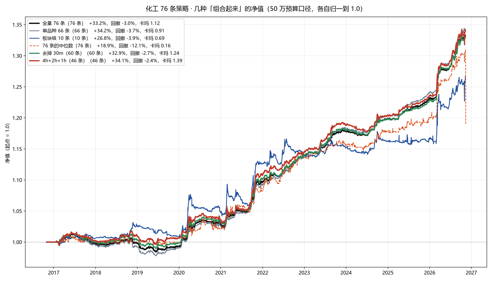
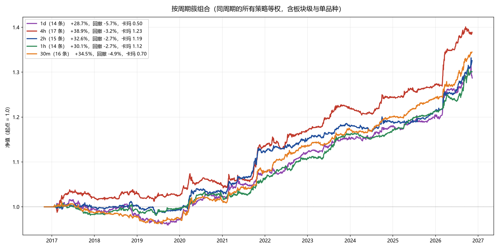
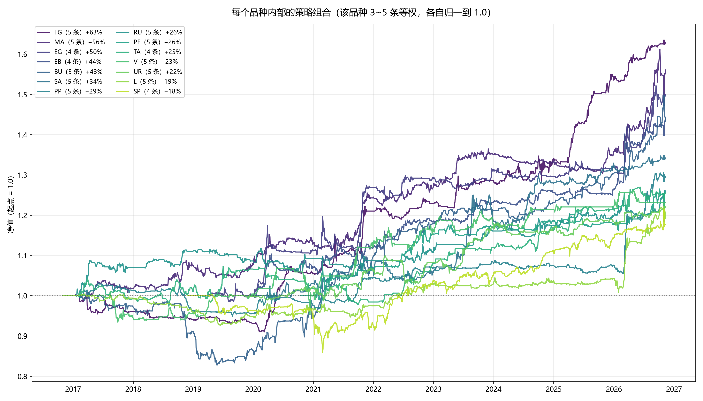

# 化工 76 条 · 几种「组合起来」的净值

> 口径：每条策略用自己 50 万预算跑出来的曲线，**归一化到 1.0 后动态等权平均**
> （每个时点只对当时有数据的策略取平均；终点统一到所有腿里最早的结束日；
> 回撤分母是本金）。这里的「等权」是**水平平均（配一次资金不动）**，
> 换成收益链式（每天再平衡）三档分别是 1.12 / 0.88 / 0.76，排序不变，见
> `chem_single66_review.md` 的「口径修正三」。
> 这是**信号层面**的组合，回答「这批策略混在一起长什么样」；资金怎么分配、手数怎么取整，
> 看 `chem_combo_review.md`（那份是按分到的钱重跑）。
> 复现：`combo2_chem.py`（用缓存，几秒钟）。

> ⚠️ **本报告的数字在 2026-11-14 修正过两次，第一次结论翻了。** 第一版把组合曲线的终点
> 交给「最后一行数据」，而各腿最后一天并不相同（30m 到 11-10、1d 到 11-12），
> 末尾几天只剩少数几条有值，那几条正好在跌 ⇒ 整条曲线被最后一根垂直砸下去。
> 影响：板块级 10 条从 0.83 显示成 0.34、全量 76 条从 1.13 显示成 0.29。
> 第二次是把回撤分母从「历史峰值」改成「本金」（与平台 `metrics` 一致）——
> 净值得涨得越多，峰值口径低估越狠，板块级 10 条 0.83→**0.69**。
> 下面全部是最终数字，详见 `chem_single66_review.md` 的两节「口径修正」。

## 一句话

**全量 76 条一把梭就行**：累计 +33.2%、最深回撤 −3.0%、卡玛 **1.12**。
想再优化，顺序是 **去掉 30m（1.24）→ 只留 4h+2h+1h（1.39）**，
但提升是 11% 和 24%，不是数量级 —— 不存在「把差的一摘掉就翻倍」这种事。

## 一、六种组合

| 组合 | 条数 | 累计 | 年化 | 最深回撤 | 卡玛 | 年化波动 |
|---|---|---|---|---|---|---|
| **全量 76 条** | 76 | +33.2% | 3.31% | −3.0% | **1.12** | 1.5% |
| 单品种 66 条 | 66 | +34.2% | 3.41% | −3.7% | 0.91 | 1.5% |
| 板块级 10 条 | 10 | +26.8% | 2.67% | −3.9% | 0.69 | 3.0% |
| 76 条的中位数 | — | +18.9% | 1.88% | −12.1% | 0.16 | 3.9% |
| **去掉 30m（60 条）** | 60 | +32.9% | 3.28% | −2.7% | **1.24** | 1.6% |
| **4h+2h+1h（46 条）** | 46 | +34.1% | 3.41% | **−2.4%** | **1.39** | 1.8% |

三个值得注意的地方：

1. **全量 76 条一点都不差**（1.12）。它的回撤 −3.0% 比单品种 66 条（−3.7%）还浅，
   因为那 10 条板块级各自内部已经是 14 品种等权，加进来相当于又叠了一层分散。
2. **板块级 10 条（0.69）明显低于单品种 66 条（0.91）**。单看每条它们更稳
   （上一份报告里卡玛中位 0.40 对 0.27），但**只有 10 条**，合起来不如 66 条摊得开。
   **「单条稳」不等于「组合稳」，条数才是分散的主要来源。**
   （峰值口径下这个差距只有 0.83 对 0.93、看着像噪声；本金口径才露出真实差距
   —— 因为板块级那条净值涨到 1.27，回撤被低估的幅度最大。）
3. **「中位数」（0.16）是全部里最差的** —— 它只是取中间那条，没有分散效果。
   很多人看「66 条的中位数曲线还不错」就以为组合也差不多，不是的。

## 二、周期簇：30m 偏弱，但不是最差

| 周期簇 | 条数 | 累计 | 卡玛 | 最深回撤 | 单条中位卡玛 → 组合后 |
|---|---|---|---|---|---|
| 1d | 14 | +28.7% | **0.50** | −5.7% | 0.27 → 0.50 |
| **4h** | 17 | **+38.9%** | **1.23** | −3.2% | 0.37 → **1.23** |
| 2h | 15 | +32.6% | 1.19 | −2.7% | 0.28 → 1.19 |
| 1h | 14 | +30.1% | 1.12 | −2.7% | 0.27 → 1.12 |
| 30m | 16 | +34.5% | **0.70** | −4.9% | 0.23 → 0.70 |

看最后一列：4h/2h/1h 组合后卡玛提升 3.3~4.1 倍，30m 提升 3.0 倍（0.23 → 0.70）——
**30m 不是「无效」，只是提升幅度和绝对水平都偏低**。它的问题在两个地方：

- **笔数最多、每笔最薄**：中位 130 笔、每笔收益 0.23%（4h 0.26%、1d 0.36%、2h 0.35%），
  成本占比高；
- **回撤最深**（−4.9%，其他三个周期簇都是 −2.7%~−3.2%）。

去掉它：76 条 1.12 → 60 条 1.24（**+11%**）。这个提升幅度只值得在你已经有 60 条管道时考虑，
不值得为它单独设计一套系统。

**1d 反而是最弱的一簇**（0.50），比 30m 还低 —— 因为它只有 14 条、且日线信号稀少
（中位 78 笔），组合后没有足够的腿来分摊。

## 三、14 个品种各自的组合

每个品种把自己那 3~5 条等权（同品种不同周期），看「这个品种上到底能不能做出东西」。

| 品种 | 条数 | 累计 | 卡玛 | 最深回撤 |
|---|---|---|---|---|
| FG 玻璃 | 5 | **+62.8%** | 0.68 | −9.2% |
| MA 甲醇 | 5 | +56.1% | 0.44 | −12.7% |
| EG 乙二醇 | 4 | +49.9% | 0.75 | −8.4% |
| **EB 苯乙烯** | 4 | +44.2% | **1.23** | **−5.1%** |
| BU 沥青 | 5 | +43.3% | **0.24** | **−18.0%** |
| SA 纯碱 | 5 | +34.2% | 0.56 | −8.7% |
| PP 聚丙烯 | 5 | +29.5% | 0.35 | −8.3% |
| RU 橡胶 | 5 | +25.8% | 0.39 | −6.6% |
| PF 短纤 | 5 | +25.7% | 0.59 | −7.2% |
| TA PTA | 4 | +25.4% | 0.26 | −9.6% |
| V PVC | 5 | +23.2% | 0.20 | −11.8% |
| UR 尿素 | 5 | +22.1% | 0.44 | −6.9% |
| L 塑料 | 5 | +19.2% | 0.25 | −7.8% |
| SP 纸浆 | 4 | +17.7% | **0.15** | **−14.4%** |

- **EB 是唯一「又赚又稳」**：+44.2% 配 −5.1% 回撤，卡玛 1.23。
- **BU 是反面**：收益排第五但回撤 −18.0%（2019 年跌到 0.84），卡玛只有 0.24。
- **SP / V / L 是尾部**：卡玛 0.15~0.25。
- FG 收益最高（+62.8%）但卡玛 0.68 —— 靠的是 30m 那条 +100.8%，回撤 −9.2%。
- MA 收益第二（+56.1%）卡玛只有 0.44：2019 年那条腿跌到 −12.7%，
  是「赚得多但坐得深」的典型，和 FG 不是一类。

## 怎么用

| 情形 | 做法 | 卡玛 |
|---|---|---|
| 只能上 3~5 条 | 板块级里挑 2h/4h 的（每条自带 14 品种分散） | ~0.4 |
| 能上十几条 | 按周期簇配：4h、2h、1h 各几条 | ~1.1~1.2 |
| 能上几十条（CTA 户） | **全上 76 条**，或 4h+2h+1h 46 条 | **1.12 / 1.39** |
| 别做 | 只上 1d 那一簇 | 0.50 |

**核心结论：条数够多时，全上就行。** 76 条一把梭 1.12，精心筛到 46 条 1.39，
中间差了 24% —— 值不值得取决于你的执行成本，而不是策略本身。
真正没用的只有「只挑几条」：k=1 的卡玛中位 0.28，k=25 就 0.90，见
`chem_single66_review.md` 的饱和曲线。
