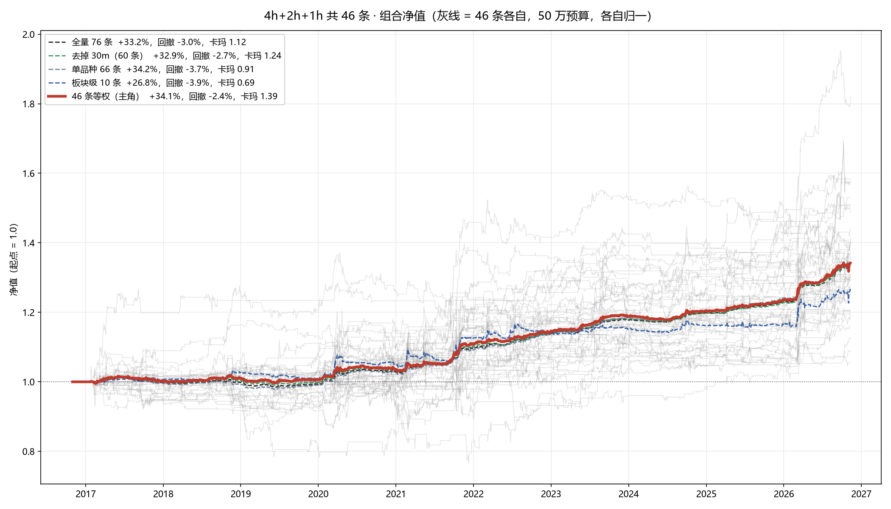
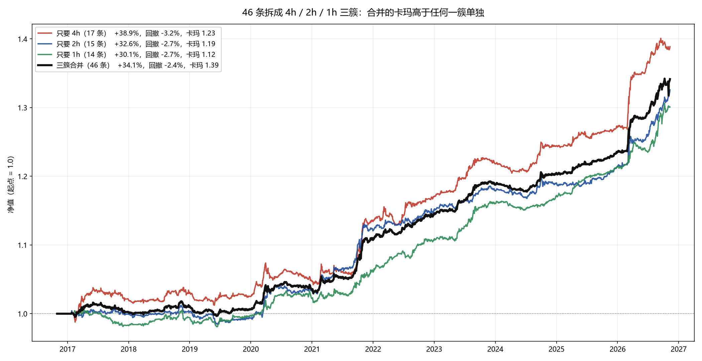
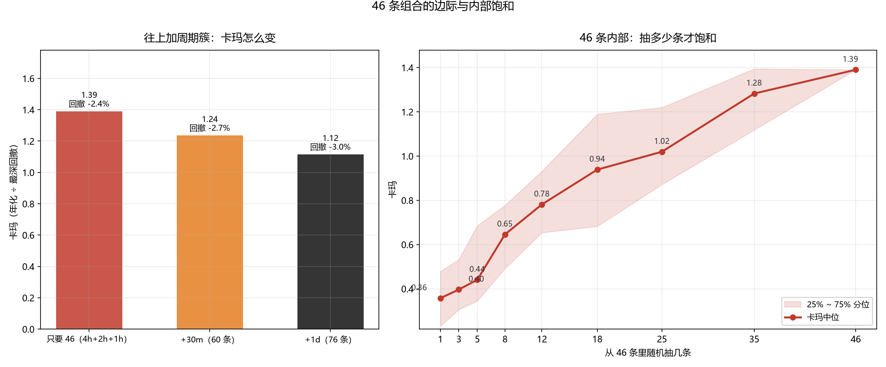

# 4h + 2h + 1h 共 46 条 · 组合曲线

> 46 条 = **4h 17 条 + 2h 15 条 + 1h 14 条**（含板块级与单品种，凡周期是这三个的都算）。
> 口径：每条用自己 50 万预算跑出来的净值，各自归一化到 1.0，**水平平均、动态等权**
> （每个时点只对当时有数据的腿平均）；**终点 = 所有腿里最早的结束日**；
> **回撤分母 = 本金**（与平台 `backtest.metrics` 一致）。
> 复现：`combo46_chem.py`（读缓存，约 25 秒）。

## 先回答那个 1.61

**1.61 是旧口径（回撤除以历史峰值）算出来的，按本金口径是 1.39。**
两个数都是这条曲线，差别只在分母：

| 口径 | 累计 | 最深回撤 | 卡玛 |
|---|---|---|---|
| 旧的：回撤 ÷ 历史峰值 | +34.1% | −2.1% | **1.61** |
| **现在的：回撤 ÷ 本金（同平台）** | **+34.1%** | **−2.4%** | **1.39** |
| 收益链式（每天再平衡，只做对照） | +36.0% | −2.0% | 1.77 |

净值涨到 1.34，同一次下跌用峰值当分母就少算 12.5%（−2.1% vs −2.4%）。列在这里是因为**这 46 条恰好是
「净值涨得多」的一组，旧口径对它的高估最大**（76 条只从 1.13 变 1.12、板块级从 0.83 变 0.69）。
往后报告一律用本金口径。

## 一、曲线

灰线是 46 条各自单独，红线是等权组合。

| 组合 | 条数 | 累计 | 年化 | 最深回撤 | 卡玛 | 年化波动 |
|---|---|---|---|---|---|---|
| **4h+2h+1h** | **46** | **+34.1%** | 3.41% | **−2.4%** | **1.39** | 1.8% |
| 去掉 30m（= 46 + 1d） | 60 | +32.9% | 3.28% | −2.7% | 1.24 | 1.6% |
| 全量 | 76 | +33.2% | 3.31% | −3.0% | 1.12 | 1.5% |
| 单品种 | 66 | +34.2% | 3.41% | −3.7% | 0.91 | 1.5% |
| 板块级 | 10 | +26.8% | 2.67% | −3.9% | 0.69 | 3.0% |

**收益几乎一模一样（+32.9%~+34.2%），差别全在回撤。** 这就是「同一批信号、
不同拼法」的典型样子 —— 46 条并没有赚更多，它只是**把坑挖得更浅**（−2.4% vs −3.7%）。

## 二、为什么合并后比任何一簇都强

| 簇 | 条数 | 累计 | 最深回撤 | 卡玛 | 年化波动 |
|---|---|---|---|---|---|
| 只要 4h | 17 | **+38.9%** | −3.2% | 1.23 | 2.3% |
| 只要 2h | 15 | +32.6% | −2.7% | 1.19 | 2.1% |
| 只要 1h | 14 | +30.1% | −2.7% | 1.12 | 1.8% |
| **三簇合并** | **46** | +34.1% | **−2.4%** | **1.39** | 1.8% |

**4h 单独收益最高（+38.9%）但回撤也最深（−3.2%），合并后收益让掉 4.8 个点、
换来回撤从 −3.2% 压到 −2.4%，卡玛 1.23 → 1.39。** 这是三个簇之间相关性低换来的：

| 日收益相关 | 4h | 2h | 1h |
|---|---|---|---|
| 4h | 1.00 | 0.46 | **0.22** |
| 2h | 0.46 | 1.00 | 0.50 |
| 1h | **0.22** | 0.50 | 1.00 |

**4h 与 1h 只有 0.22** —— 同品种、同因子体系，仅仅换了周期，相关性就掉到接近无关。
这 46 条能到 1.39，靠的就是这个：不是「策略多」，而是**周期把假设切成了 3 份**。
（对照：46 条与全量 76 条相关 0.91、与单品种 66 条 0.86 —— 同一批东西换个拼法。）

## 三、再往上加就变差

左边：46（1.39）→ 加 30m 变 60 条（1.24）→ 再加 1d 变 76 条（1.12）。
**30m 和 1d 是净拖累**，各拉掉约 11% 和 10% 的卡玛。原因不是它们「不赚」：

- 30m 有 16 条、笔数中位 130 笔、每笔最薄 ⇒ 回撤 −4.9%，接近 46 条（−2.4%）的两倍；
- 1d 只有 14 条、信号稀（中位 78 笔）⇒ 卡玛 0.50、回撤 −5.7%，自身弱，与 46 条相关又不低，帮不上忙。

## 四、46 条内部：还没饱和

右边：从 46 条里随机抽 k 条、40 次取中位。

| 抽几条 | 1 | 3 | 5 | 8 | 12 | 18 | 25 | 35 | 46 |
|---|---|---|---|---|---|---|---|---|---|
| 卡玛中位 | 0.36 | 0.40 | 0.44 | 0.65 | 0.78 | 0.94 | 1.02 | 1.28 | **1.39** |
| 最深回撤 | −12.5% | −8.1% | −7.0% | −5.0% | −4.3% | −3.6% | −3.1% | −2.6% | −2.4% |
| 25~75% | .23~.48 | .31~.53 | .35~.69 | .49~.78 | .65~.93 | .68~1.19 | .87~1.22 | 1.12~1.39 | — |

**注意和 66 条那组不一样**：66 条的拐点在 25 条（之后不再提升），而 46 条**到 46 条还在涨**
（35 → 46 从 1.28 涨到 1.39）。因为 46 条里三簇各只有 14~17 条，摊到每个簇还远没有饱和；
66 条那组已经把这个板块能测的组合基本用完了。

## 五、年度（46 条）

| 年 | 2016* | 2017 | 2018 | 2019 | 2020 | 2021 | 2022 | 2023 | 2024 | 2025 | 2026* |
|---|---|---|---|---|---|---|---|---|---|---|---|
| 收益 | +0.0% | +0.3% | +0.8% | −0.5% | +2.8% | **+6.9%** | +3.3% | +3.6% | +1.4% | +2.6% | **+8.5%** |

\*2016 只有 10-31 起两个月；2026 只到 11-10（0.86 年）。

**十年 +34.1% 里 2021 和 2026 贡献了近一半（15.4 个点）**，2016~2019 四年合计只 +0.6%。
这条曲线的真实性格是：**长期接近零，靠两波行情翻身**，不是「稳定小赚」。
均摊到 10 年是 3.41%/年，回撤 −2.4% —— 卡玛好看，是因为分母（回撤）被 46 条摊薄了，
不代表每年都有 3.4%。

## 怎么用

| 情形 | 做法 | 卡玛 |
|---|---|---|
| 想省执行成本 | 46 条里抽 18~25 条（三簇各抽 6~8 条） | 0.94~1.02 |
| **想拿最好的风险调整** | **46 条全上（4h+2h+1h）** | **1.39** |
| 已经有全量 76 条 | 把 30m 那 16 条和 1d 那 14 条停掉，换 46 条 | 1.12 → 1.39 |
| 别做 | 只留 4h（收益最高但回撤深一倍）、只留 1d | 1.23 / 0.50 |

> **别把 1.39 当成预期收益。** 它是「十年 +34%、回撤 2.4%」的比值，
> 而 +34% 里 45% 来自 2021 和 2026 两段。真正要问的是：
> 如果 2021 和 2026 那种行情不再来，这 46 条还剩多少？答案在 2016~2019 那四年：+0.6%。
