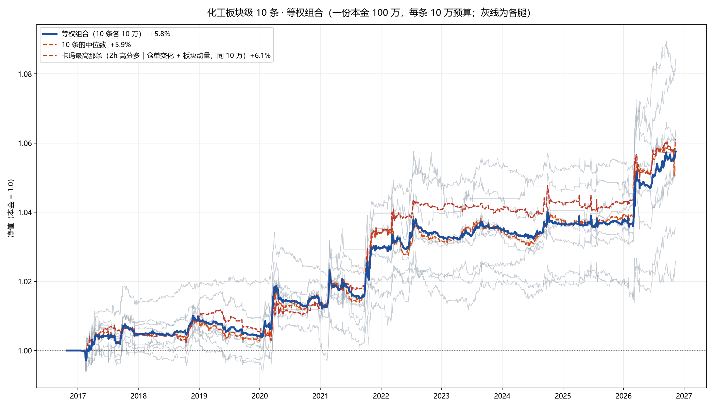
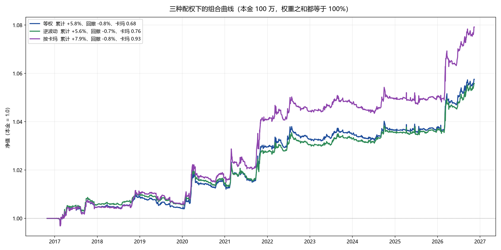
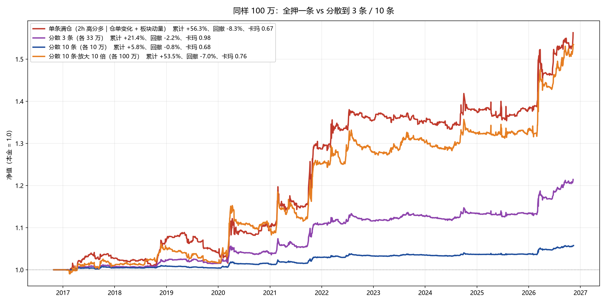
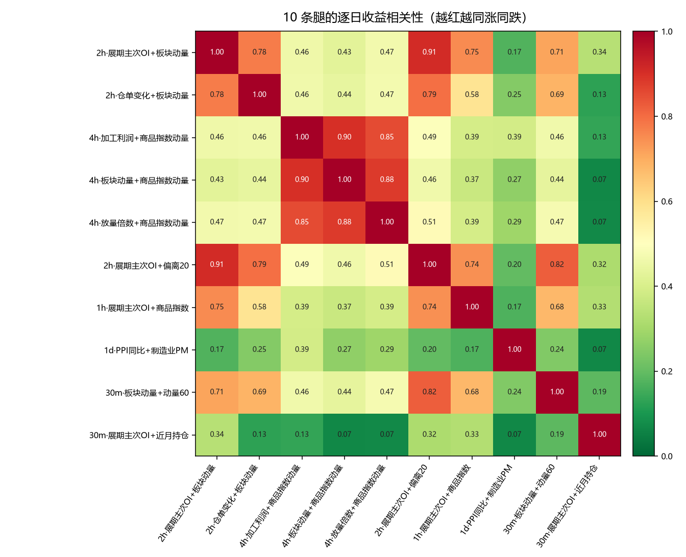
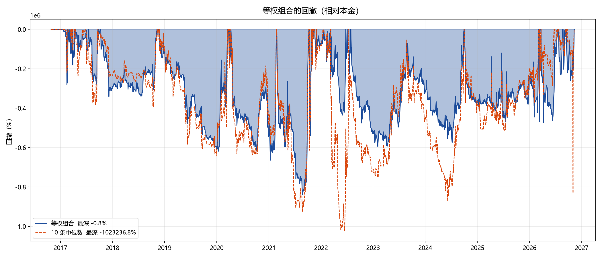

# 化工板块级 10 条 · 组合起来看

> 口径：一份本金 100 万，`sizing="budget"`，全样本（2016-10 起）。组合是**每条腿按分到的钱重跑**
> （改 `capital_pct`），不是拿现成曲线乘个权重 —— `budget` 口径有「保底 1 手」，
> 预算砍到 1/10 不是线性缩放。复现：`combo_chem.py`。

## 一句话

**分散有用，但也就那样。** 把 10 条放大到同一敞口，收益 53.5% 对单条 56.3%（几乎打平），
回撤 7.0% 对 8.3%，**卡玛 0.76 对 0.67（+13%）**。提升来自「不用挑」——
单条那 0.67 是你事后知道哪条最好才拿得到的。

真正拖后腿的是相关性：**10 条的中位相关性 0.44、最高 0.91**，它们其实只有 4 个独立假设。

---

## 一、等权组合

100 万分给 10 条、每条 10 万预算：**累计 +5.8%、回撤 −0.8%、卡玛 0.68、年化波动 0.7%**。

灰线是 10 条腿（同样 10 万预算，终值 1.02~1.08），蓝线是组合，红虚线是卡玛最高那条
（+6.1%）。组合落在中位数（+3.8%）之上、最好那条之下 —— 这正是等权的样子。

> ⚠️ 别把 **+5.8%** 和报告里单条的 **+28%** 比：那 28% 是那条策略独占 50 万预算的成绩，
> 分到组合里只有 10 万。**预算砍到 1/5，收益就是 1/5**，这个是线性缩放，不是策略变差。

## 二、三种配权

| 配权 | 权重范围 | 累计 | 回撤 | 卡玛 | 年化波动 |
|---|---|---|---|---|---|
| 等权 | 10% × 10 | +5.8% | −0.8% | 0.68 | 0.7% |
| 逆波动（1/σ） | 8% ~ 16% | +5.6% | −0.7% | 0.76 | 0.6% |
| 按卡玛 | 4% ~ 17% | **+7.9%** | −0.8% | **0.93** | 0.9% |

按卡玛明显最好，但**它用的是全样本卡玛**（事后信息），有前视，只能当上界看。
逆波动不需要方向判断、只用波动率，算是较能落地的加权方式（0.76）。

## 三、同口径对照：分散到底换来了什么

| 方案 | 总敞口 | 累计 | 年化 | 回撤 | 卡玛 |
|---|---|---|---|---|---|
| 单条满仓（2h 仓单变化 + 板块动量） | 100 万 | +56.3% | 5.61% | −8.3% | 0.67 |
| 分散 3 条（各 33 万） | 100 万 | +21.4% | 2.14% | −2.2% | **0.98** |
| 分散 10 条（各 10 万） | 100 万 | +5.8% | 0.57% | −0.8% | 0.68 |
| **分散 10 条 · 放大 10 倍（各 100 万）** | **1000 万** | **+53.5%** | 5.32% | **−7.0%** | **0.76** |

- 前三行的收益差（56% / 21% / 5.8%）**几乎全是资金分配比例**，跟分散好坏没关系 ——
  敞口 1 : 1/3 : 1/10，收益也 1 : 1/3 : 1/10。
- 真正可比的是最后一行：**同样的收益率水平下，回撤小 1.3pp、卡玛高 13%**。
- **分散 3 条卡玛 0.98 最漂亮，但那 3 条是事后按卡玛挑的**，不能当作可执行方案。
  等权 10 条不需要知道哪条好，0.76 就是「闭眼配」的水平 —— 这才是分散的真实价值。

## 四、为什么提升有限：10 条其实只有 4 个假设

| | 中位 | 最高 | 最低 |
|---|---|---|---|
| 日收益相关性 | **0.44** | **0.91** | 0.07 |

能看得很清楚的三团：

| 簇 | 成员 | 簇内相关 | 说明 |
|---|---|---|---|
| **4h 商品指数系** | 加工利润 + 商品指数动量、板块动量 + 商品指数动量、放量倍数 + 商品指数动量 | **0.85 ~ 0.90** | 三条本质是同一条 |
| **2h 展期/仓单系** | 展期主次OI + 板块动量、仓单变化 + 板块动量、展期主次OI + 偏离20均线 | **0.74 ~ 0.91** | 换个因子上车而已 |
| **1d 宏观** | PPI同比 + 制造业PMI + 商品指数动量 | 与其余 **0.17 ~ 0.39** | 唯一真正独立的一条 |
| **30m 近月持仓** | 30m 展期主次OI + 近月持仓 | 与其余 **≤ 0.34** | 独立，但收益最弱 |

所以「10 条策略」= **4 个假设**。按假设数算，分散到 4 个就已经到头，
再加 6 条同簇的只是把仓位摊薄 —— 这跟「组合按假设数、不按策略数」是一个道理。

想让卡玛再上一个台阶，得加**别的板块**（黑色、有色、农产品）或者**换假设类型**
（截面多空、跨品种价差），继续在化工里堆同类动量/OI 因子没用。

## 五、回撤

等权组合最深 −0.8%（10 万预算），中位数那条 −1.0%。
放大到 1000 万敞口后是 −7.0%，比单条的 −8.3% 浅，但**三个坑一模一样**：
2019 全年、2020 年初、2021 年底。分散削的是幅度，削不掉时点。

## 结论

1. **要用就等权配 10 条，按目标波动放大杠杆**，卡玛约 0.76、最大回撤 7%（1000 万敞口）。
   别去挑「最好的那条」—— 那需要事后信息。
2. **别再往化工里加同类策略**：相关性 0.44、最高 0.91，加第 11 条几乎没有边际收益。
3. 想要更高卡玛，缺的是**跨板块**和**跨假设类型**，不是更多参数组合。
4. 若坚持单条跑（比如资金只够一条），选 2h 那两条（卡玛 0.67）比 4h 的稳 ——
   4h 赚得多但 2021 年底回撤更深。
