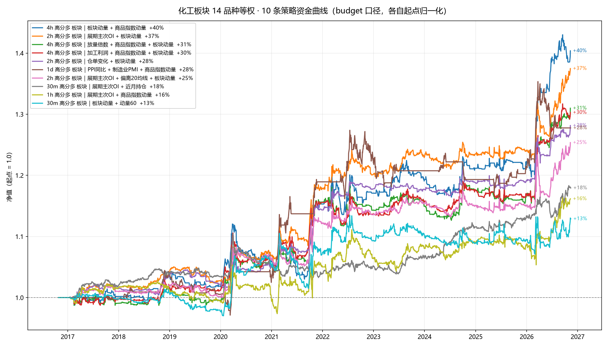
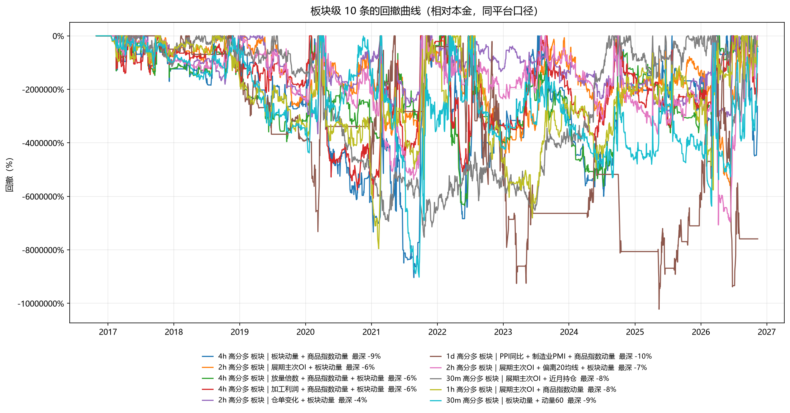
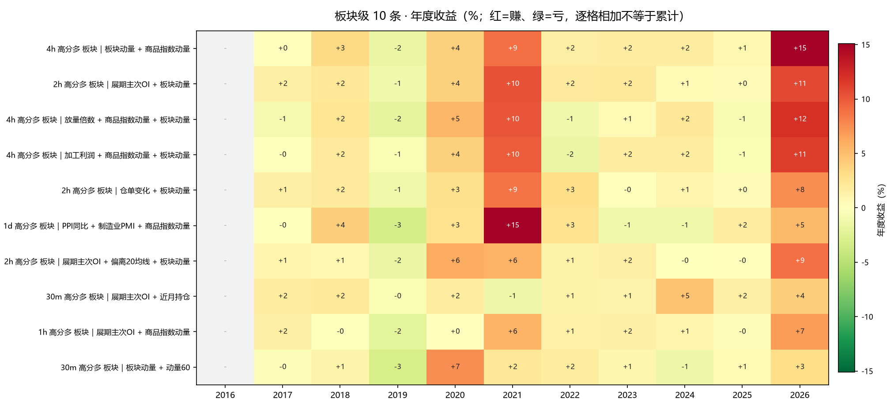
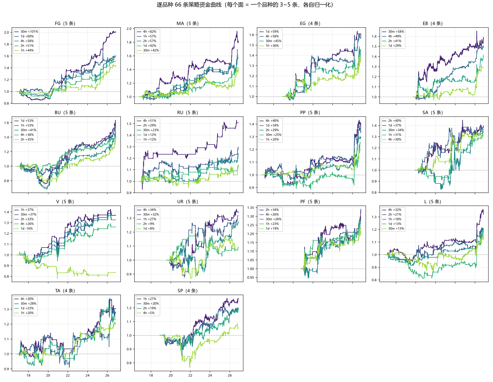
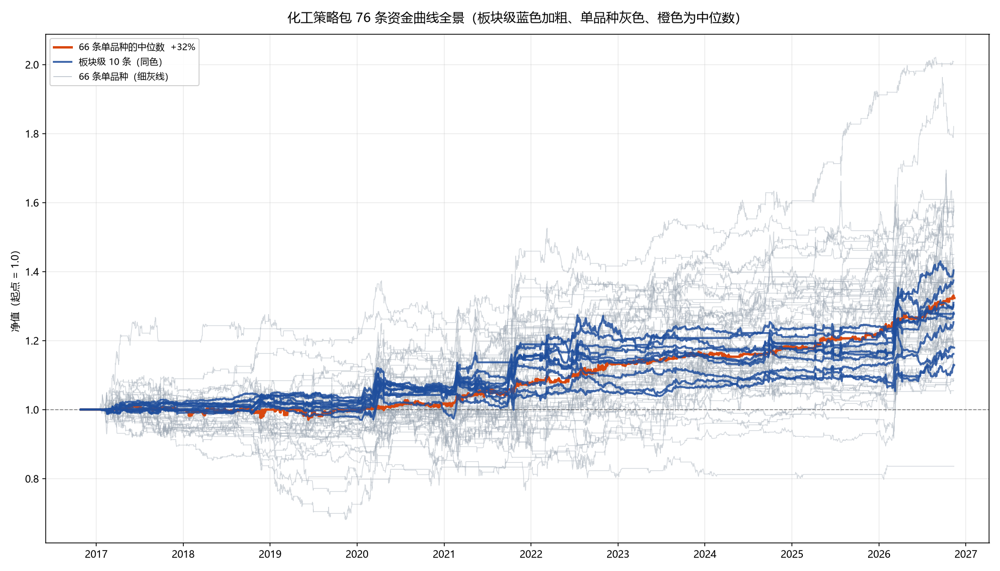

# 化工策略包 76 条 · 资金曲线复盘

> 数据来源：策略库里搜「化工」的 76 条（`load_library()` 磁盘读 → `replay.run` / `replay.run_multi`）。
> 口径与注册时一致：`sizing="budget"`（分配 50 万买货，不是保证金杠杆）、`range_years=0`（全样本）、
> 固定方向（`long_high` / `long_low`）。复现：`collect_chem_equity.py` → `plot_chem_equity.py`。

## 一句话

**收益是真的，但不是「稳定年化 3.7%」** —— 10 年 +37.5% 里，2021 和 2026 两个大行情年贡献了近一半，
其余 8.25 年年化只有 0.8~1.2%。它的性质更接近「长期几乎不动 + 趋势年跟得上板块」，不是全天候 alpha。

---

## 一、板块级 10 条（主力，14 品种等权）

10 条全部为正（+13% ~ +40%），但曲线高度同步 —— **2020 年中、2021 年、2026 年三处集体抬升**，
说明它们吃的是同一份板块 beta，不是各自独立的 alpha。想分散就得分到别的板块去。

| # | 策略 | 累计 | 卡玛 | 最深回撤 | 笔数 |
|---|---|---|---|---|---|
| 1 | 板块动量 + 商品指数动量（4h） | **+40.4%** | 0.45 | −9.0% | 2362 |
| 2 | 展期主次OI + 板块动量（2h） | +37.5% | **0.67** | −5.6% | 2368 |
| 3 | 放量倍数 + 商品指数动量 + 板块动量（4h） | +31.0% | 0.49 | −6.3% | 2844 |
| 4 | 加工利润 + 商品指数动量 + 板块动量（4h） | +30.3% | 0.50 | −6.1% | 1569 |
| 5 | 仓单变化 + 板块动量（2h） | +28.1% | 0.67 | **−4.2%** | 2062 |
| 6 | PPI同比 + 制造业PMI + 商品指数动量（1d） | +27.8% | 0.27 | −10.2% | 321 |
| 7 | 展期主次OI + 偏离20均线 + 板块动量（2h） | +25.4% | 0.36 | −7.1% | 1950 |
| 8 | 展期主次OI + 近月持仓（30m） | +17.9% | 0.24 | −7.5% | 1067 |
| 9 | 展期主次OI + 商品指数动量（1h） | +16.2% | 0.20 | −8.0% | 3442 |
| 10 | 板块动量 + 动量60（30m） | +12.9% | 0.14 | −9.0% | 3810 |

**卡玛最高的是 2h 那两条（0.67）**，不是收益最高的 4h —— 4h 赚得多但也跌得深（−9.0%）。

回撤中位 −7.3%，最深 −10.2%（冠军组合那条）。**2019 全年、2020 年初、2021 年底到 2022 年初**
是三个共同的坑；2021 底的坑最深也最同步 —— 同涨同跌这一点在这里看得最清楚。

## 二、收益到底从哪来

| 区间 | 跨度 | 中位收益 | 年化 | 为正条数 |
|---|---|---|---|---|
| 2016-10 ~ 2020-12 | 4.25 年 | +5.2% | **1.2%/年** | 9/10 |
| 2021 | 1 年 | **+8.8%** | 8.8%/年 | 9/10 |
| 2022 ~ 2025 | 4 年 | +3.1% | **0.8%/年** | 10/10 |
| 2026（到 11 月） | 0.87 年 | **+8.2%** | 9.4%/年 | 10/10 |

- **全年全赚的年份**：2020、2026；**全年全亏的年份**：2019（2016 只有 2 个月，不算）。
- 2021 那一格最刺眼：冠军组合 +15%、其余 +6~+10%。2026 也是 +3~+15%。
- 剩下 8 年多基本在 −3% ~ +3% 之间磨 —— 10 条策略、5 个周期、14 个品种，
  **在同一年里方向高度一致**，这是 beta 的特征。

> 这不是说策略没用。**「趋势年跟得上、震荡年不亏大钱」本身就是一种可交易的属性**，
> 但把它当成每年稳定 3~4% 的年化去配资金，就会在 2019 那种年份失望。
> 真要提高非趋势年的收益，得换假设（截面多空、跨品种价差），不是继续在这套动量/OI 因子上调参。

## 三、逐品种 66 条

65/66 为正（唯一为负的是 V 1d `展期主次OI+展期年化主次` −16.4%，报告里已标 🟥）。
中位数净值 1.32（+32.3%），中位回撤 **−13.1%**。

- 最强：**FG 30m 低分多「现货基差+收盘位置+主力持仓」+100.8%**（248 笔）、MA 4h +82.1%、FG 1d +60.2%；
- 最弱：UR 1d +8.4%（40 笔）、SP 4h +5.5%（77 笔）、V 1d −16.4%（36 笔）；
- **同品种内部差异很大**：FG 的 5 条从 +44% 到 +101%，MA 从 +42% 到 +82%。
  这说明「挑对周期」比「挑对品种」更关键 —— 同一个品种换周期，收益能差一倍。

## 四、板块级 vs 逐品种：差在回撤，不在收益

| | 条数 | 收益中位 | 卡玛中位 | 回撤中位 |
|---|---|---|---|---|
| 板块级（14 品种等权） | 10 | +28.0% | **0.40** | **−7.3%** |
| 逐品种（单品种） | 66 | +32.3% | 0.27 | −13.1% |

收益差不多（甚至单品种更高），但**回撤差近一倍**，所以卡玛差 1.5 倍。
这是分散的直接效果：单品种那条曲线在 2019~2020 跌 −15%~−25%，板块级同一时间只跌 −6%~−8%。

⇒ **要配置就用板块级 10 条；逐品种那 66 条是「这个品种上什么因子顺手」的索引**，
单条拿出来做，回撤会比数字看起来难受得多。

## 五、按周期

| 周期 | 逐品种中位收益 | 板块级中位收益 | 板块级卡玛 |
|---|---|---|---|
| 1d | +28.9% | +27.8% | 0.27 |
| **4h** | **+35.3%** | +31.0% | 0.49 |
| 2h | +33.3% | +28.1% | **0.67** |
| 1h | +27.3% | +16.2% | 0.20 |
| 30m | +32.6% | +15.4% | 0.19 |

**4h 收益最好、2h 卡玛最高、30m/1h 明显掉队**。和之前扫描的结论一致（自动方向下 4h 是甜点，
固定方向后 4h 仍然最稳）。30m 笔数最多但收益最薄 —— 成本吃掉了。

## 六、全景

灰色细线是 66 条单品种、蓝色是板块级 10 条、橙色是单品种的中位数（+32.3%）。
单品种有 3~4 条冲到 1.6~2.0（FG 30m、MA 4h 那几个），但分布很散 ——
**中位数和最好那条差 3 倍**，这正是「逐品种挑选」的过拟合风险所在：
库里躺着的是 70 格 × 24 因子的最优解，真实交易中你选中那条最好的概率远低于 1/66。
