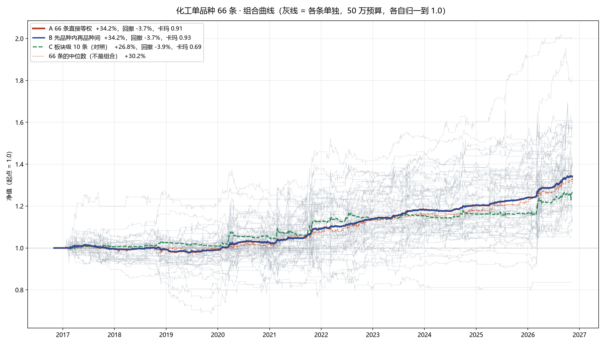
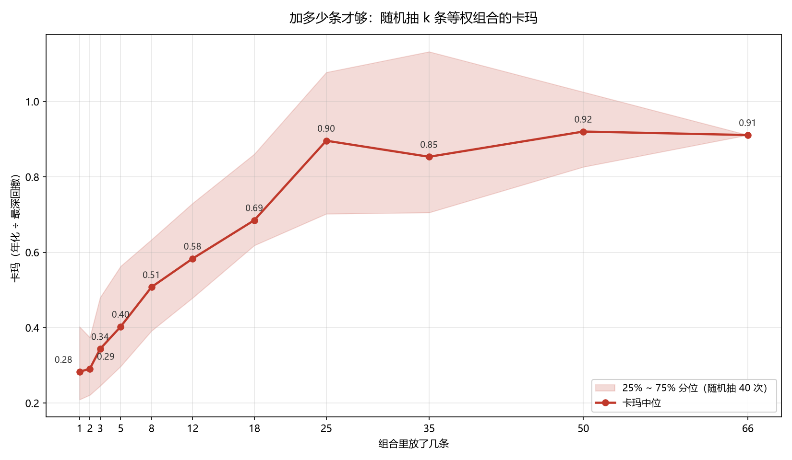
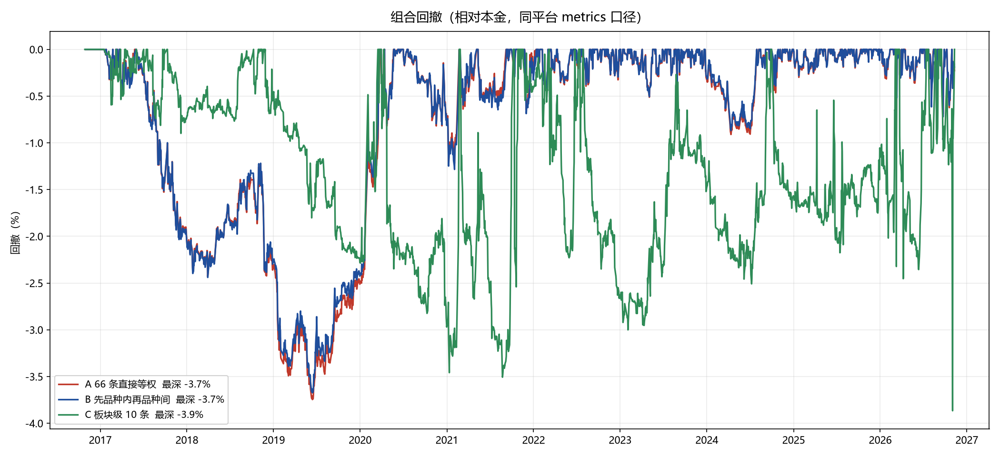
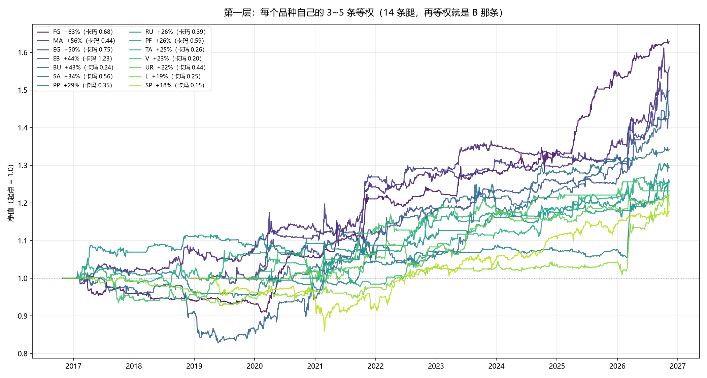

# 化工单品种 66 条 · 组合曲线

> 数据：策略库里搜「化工」的 66 条单品种策略（不含 10 条板块级）。
> 口径：每条用自己 50 万预算跑出来的净值，**各自归一到 1.0 后动态等权平均**
> —— 每个时点只对当时有数据的策略平均（PF 2020-10 才上市，不能假装它早就在）。
> **终点统一到所有腿里最早的那个最后日期**，**回撤分母=本金**（见文末两节「口径修正」）。
> 复现：`combo_single66.py`（读缓存，约 20 秒）。

## 一句话

**66 条等权：累计 +34.2%、最深回撤 −3.7%、卡玛 0.91。**
单条中位回撤是 −13.1%，组合后压到 −3.7% —— 分散在这里非常有效（回撤降 3.5 倍）。

而**加到 25 条左右就基本到顶了**（卡玛 0.90，66 条是 0.91），再加只是把尾巴压平一点。

---

## 一、组合曲线

灰线是 66 条各自单独（单条之间有 3 倍差距：最好 FG 30m +100.8%，最差 V 1d −16.4%），
红线是等权组合。

| 组合 | 累计 | 年化 | 最深回撤 | 卡玛 | 年化波动 |
|---|---|---|---|---|---|
| **A 66 条直接等权** | **+34.2%** | 3.41% | **−3.7%** | **0.91** | 1.5% |
| **B 先品种内、再品种间** | **+34.2%** | 3.41% | −3.7% | **0.93** | 1.5% |
| C 板块级 10 条（对照） | +26.8% | 2.67% | −3.9% | 0.69 | 3.0% |
| 单条中位数（不是组合） | +30.2% | 3.01% | −3.9% | 0.77 | 3.7% |

- **A 和 B 几乎一样**（0.91 vs 0.93）。B 是「每个品种先把自己 3~5 条等权，14 个品种再等权」，
  目的是消掉「5 条的品种比 4 条的品种权重多 25%」这个偏差 —— 实测影响 0.02，可以忽略。
  说明这 14 个品种的强弱差异不足以让权重偏差变成问题。
- **C（板块级 10 条）比 A 差**：+26.8% / 0.69。同样是「化工 14 品种」，
  10 条组合比 66 条组合的波动高一倍（3.0% vs 1.5%）、回撤还略深 —— **条数才是分散的来源，
  单条内部再分散也替代不了条数**。
- **中位数（0.77）比组合（0.91）差**：取中间那条没有分散效果。

## 二、加到多少条就够

随机抽 k 条、等权组合，重复 40 次取中位（阴影是 25%~75% 分位）：

| 条数 | 1 | 3 | 5 | 8 | 12 | 18 | **25** | 35 | 50 | 66 |
|---|---|---|---|---|---|---|---|---|---|---|
| 卡玛中位 | 0.28 | 0.34 | 0.40 | 0.51 | 0.58 | 0.69 | **0.90** | 0.85 | 0.92 | 0.91 |
| 最深回撤 | −12.3% | −8.5% | −8.4% | −6.8% | −5.7% | −4.6% | **−3.9%** | −3.9% | −3.7% | −3.7% |
| 25%~75% 分位 | 0.21~0.40 | 0.25~0.48 | 0.30~0.56 | 0.39~0.63 | 0.48~0.73 | 0.62~0.86 | **0.70~1.08** | 0.71~1.13 | 0.83~1.03 | — |

三个读法：

1. **拐点在 25 条**：0.90，之后 35 条 0.85、50 条 0.92、66 条 0.91 —— 都没有实质提升
   （35 条那个 0.85 是抽样噪声，不是真的变差）。
2. **收益基本不变**（+31%~+34%），提升全靠回撤从 −12.3% 压到 −3.9%。
   也就是说**分散不改期望，只改波动**，这跟教科书一致。
3. **条数少的时候「选哪几条」影响巨大**：k=8 时分位是 0.39~0.63（差 1.6 倍），
   到 k=25 收窄成 0.70~1.08，k=50 是 0.83~1.03。**条数够多之后，选哪几条就不重要了**
   —— 这正是「组合按假设数」的反面：条数足够覆盖假设时，挑选误差被平均掉了。

## 三、回撤

等权组合最深 −3.7%，三个坑：2018 年底、2019 年中（−3.7%）、2021 年中（−1.5%）。
C（板块级 10 条）在 2019 年那次跌到 −3.9%，比 A 还深 —— 因为只有 10 条、摊不开。

## 四、第一层：14 个品种各自的组合

B 方案的第一层，也就是「每个品种内部先等权」的样子：

| 品种 | 累计 | 回撤 | 卡玛 | 品种 | 累计 | 回撤 | 卡玛 |
|---|---|---|---|---|---|---|---|
| FG 玻璃 | +62.8% | −9.2% | 0.68 | RU 橡胶 | +25.8% | −6.6% | 0.39 |
| MA 甲醇 | +56.1% | −12.7% | 0.44 | PF 短纤 | +25.7% | −7.2% | 0.59 |
| EG 乙二醇 | +49.9% | −8.4% | 0.75 | TA PTA | +25.4% | −9.6% | 0.26 |
| EB 苯乙烯 | +44.2% | **−5.1%** | **1.23** | V PVC | +23.2% | −11.8% | 0.20 |
| BU 沥青 | +43.3% | −18.0% | 0.24 | UR 尿素 | +22.1% | −6.9% | 0.44 |
| SA 纯碱 | +34.2% | −8.7% | 0.56 | L 塑料 | +19.2% | −7.8% | 0.25 |
| PP 聚丙烯 | +29.5% | −8.3% | 0.35 | SP 纸浆 | +17.7% | −14.4% | 0.15 |

- **EB 是唯一「又赚又稳」**的（+44.2%、回撤 −5.1%、卡玛 1.23）；
- **MA 收益第二高但卡玛只有 0.44**：2019 年跌到 −12.7%，比 FG 的 −9.2% 深得多；
- **BU 相反**：+43.3% 但回撤 −18.0%（2019 年跌到 0.84），卡玛只剩 0.24；
- **14 条腿的卡玛跨度是 0.15 ~ 1.23（8 倍）**，比单条策略之间的跨度小，
  但仍说明「品种选择」比「策略选择」次要、不是不重要。

## 口径修正一：组合曲线末端假崩塌

第一版算出来：板块级 10 条 +19.5%/卡玛 **0.34**、全量 76 条 **0.29**。
修正后是 +26.8%/**0.69~0.83** 和 **1.12** —— **结论整个翻转了**（原本说「全量最差、别一把梭」）。

原因是**末端失真**：各腿最后一个 bar 日期不同（30m 到 2026-11-10、1d 到 11-12），
组合在最后几天只剩少数几条有值，如果那几条正好在跌，整条曲线会被最后一根垂直砸下去。
板块级 10 条就是这么被砸下去的。

修法：**终点统一取所有腿里最早的那个最后日期**。顺带把门槛从固定 3 条改成
「至少 1/3 的腿有数据」，让 `combo2_chem.py` 和本脚本对同一个「66 条组合」
算出同一个数（都 0.91）。

## 口径修正二：回撤分母必须是本金（同平台 `metrics`）

第一版本脚本用的是 `eq / eq.cummax() - 1`（**相对历史峰值**），而平台
`backtest.metrics` 是 `(equity - equity.cummax()) / base`（**相对本金**）。
净值涨到 1.27 时，同一次下跌用峰值口径只算出 2.9%、用本金口径是 3.7%。

影响幅度**取决于这条曲线涨了多少**：

| 组合 | 峰值口径 卡玛 | 本金口径 卡玛 |
|---|---|---|
| 66 条（净值 1.34） | 0.93 | **0.91** |
| 76 条（净值 1.33） | 1.13 | **1.12** |
| 板块级 10 条（净值 1.27） | 0.83 | **0.69** |
| 单品种 MA（净值 1.56） | 0.71 | **0.44** |

⇒ 结论没翻转（排序完全不变），但**"组合比板块级好"这件事被低估了**：
真实差距是 0.91 vs 0.69，不是 0.93 vs 0.83。本报告与 `chem_combo2_review.md`
的表格已全部改成本金口径，与平台点开看到的数字一致。

## 口径修正三：两种「等权」的差别（量级 0.03~0.07，排序不变）

上面用的是**水平平均**：一次配好资金就不再动，每个时点把当时在线的腿的净值取平均
（相当于买入持有）。另一种常见做法是**收益链式**：每天按当日收益率等权平均再累乘
（相当于每天再平衡）。两者结果：

| 组合 | 水平平均（本报告） | 收益链式（日度再平衡） |
|---|---|---|
| 全量 76 条 | +33.2% / −3.0% / **1.12** | +34.2% / −3.1% / **1.12** |
| 单品种 66 条 | +34.2% / −3.7% / **0.91** | +35.0% / −4.0% / **0.88** |
| 板块级 10 条 | +26.8% / −3.9% / **0.69** | +26.9% / −3.5% / **0.76** |

差别来自两点：水平平均里「晚上线的腿从 1.0 接入」会在接入那天把均值拉低一点；
收益链式则没有这个跳变，但隐含每天调仓。**排序和量级都一样**，所以报告采用水平平均
（它对应「配一次资金不动」，交易成本更低，也更接近实盘会做的事）。

> 教训一：**组合曲线的末尾几天必须特殊处理**（终点对齐）。回测取数截止日不同、
> 各周期最后一个 bar 不在同一天，单条策略上看不出来，一组合就变成一根垂直假跌，
> 而且它落在净值最高处附近，对「最深回撤」和「卡玛」的杀伤力最大。
>
> 教训二：**组合曲线的回撤口径必须和平台一致**，否则「净值涨得越多、回撤被低估越多」，
> 而涨得多的正好是表现好的组合 —— 等于系统性偏袒强者，会让排序看不出差别。
>
> 教训三：**报「等权组合」必须写清是水平平均还是收益链式**。这次两者给出的卡玛
> 差 0.03~0.07，足以让人以为「板块级其实没比 66 条差多少」。
