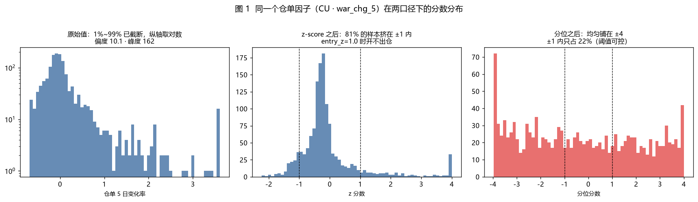
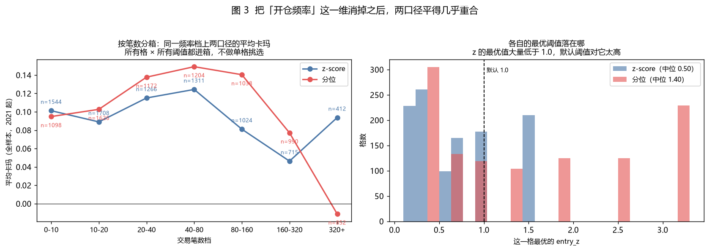
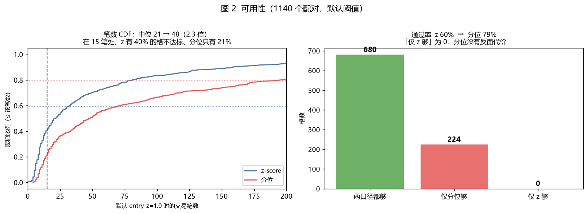
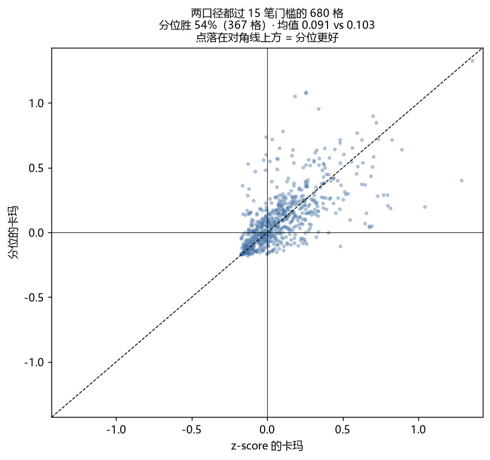

# 仓单因子该用分位还是 z-score

**结论先说**：分位确实更容易「起效」，但机制不是「分位预测力更强」，而是
**在默认阈值下它能开出足够的仓**。把开仓频率对齐之后，两种口径的质量几乎
打平（54% vs 46%）。所以正确的用法不是「全局换分位」，而是**逐因子选口径**，
并且扫描时两口径都跑一遍。

> 全部数字来自 `_tools/sector_sweep/s6_norm.py`（1270 配对）与
> `s7_thresh.py`（18480 次回测，1140 配对 × 7 阈值 × 2 口径）。
> 品种池 = 有色 10 + 能源·原油 5 + 农产·油脂油料 7 = 22 个，周期 1d/4h/2h/1h/30m，
> 区间 2021-01-01 起，IS ≤2023-12-31 / OOS ≥2024-01-01，`sizing="budget"`。

---

## 一、先把「z 会被压扁」量化

`war_chg_5`（仓单 5 日变化率）在 22 个品种上的分布（中位数，1d_tq）：

| 因子 | 偏度 | 峰度 | 1%~99% 跨度 ÷ 中位数 | z 后落在 ±1 内 | z 后顶到 ±4 | 分位后顶到 ±4 |
|---|---|---|---|---|---|---|
| `war_chg_5` | **9.6** | **122** | **4721×** | **87.9%** | 1.1% | 0.7% |
| `war_chg_1` | 7.2 | 102 | 16524× | **92.0%** | 1.2% | 0.4% |
| `war_val` | 1.6 | 2.3 | 4.2× | 61.6% | 0.4% | 1.7% |
| `war_pct` | 0.0 | −1.2 | 2.0× | 52.7% | 0.0% | 2.2% |
| `roll_main_oi` | 1.6 | 4.0 | 23× | 60.9% | 1.0% | 3.5% |
| `profit_val` | 0.6 | 0.1 | 1.1× | 51.5% | 0.7% | 1.4% |
| `spot_basis` | 0.5 | −0.7 | 3.8× | 49.4% | 0.0% | 1.3% |

读法：`entry_z=1.0` 就是「只在这根 bar 的分数超过 1 时才开仓」。
`war_chg_5` 有 **87.9% 的样本分数在 ±1 内**，等于八成时间开不出仓。
分位标准化把分数均匀铺开，±1 内只占 22%（见图 1）。



⚠️ `war_val` / `war_pct` 虽然偏度不高，但**笔数照样少**（z 下中位 8 / 9 笔）——
因为它们变化慢，分数长期贴着 0。所以「压扁」有两个来源：尾巴太长（撑大分母）、
以及因子本身波动小。分位对两者都免疫。

---

## 二、第一轮 A/B：固定 `entry_z=1.0`，两口径直接比

| | z 有效格 | 分位有效格 | 仅 z 有效 | 仅分位有效 | 笔数中位 |
|---|---|---|---|---|---|
| 仓单四件套 | 118 | 151（+28%） | 41 | **74** | 18 → 48 |
| 对照（含 `breakout_pos` 等） | 143 | 241（+69%） | 30 | **128** | 20 → 40 |

看起来分位大胜。**但这一轮的比较是错的**，见下。

---

## 三、纠错：固定阈值比两口径，等于拿不同开仓率在比

同一个 `1.0` 在两口径里含义完全不同：

- z 的 1.0 = 超出 1 个标准差（约 84 分位，但右偏因子实际远达不到）→ 开仓率 ~12%
- 分位的 1.0 = 82.5 分位线 → 开仓率 **25%**

实测笔数中位 21 → 48（2.3 倍）。这不是口径的功劳，是**频率差**。

另外我在 CU 单格上看到「z 从 0.3 调到 0.5 卡玛掉一半、分位很平」，
就写了「分位阈值不敏感」——**这条不能推广**：744 条曲线的变异系数中位数
z **0.56** vs 分位 **0.56**，完全一样。单格样板挑到谁全看运气。

---

## 四、第二轮：阈值对齐后，质量打平

两口径各跑一条阈值网格（z: 0.15~1.5，分位: 0.4~3.2，比例迟滞 `exit=0.3×entry`），
把结果画在 **(笔数, 卡玛)** 平面上比较 —— 频率这一维被消掉。

**共同笔数区间内（744 格）**：

| | 结果 |
|---|---|
| 分位胜率 | **50%**（z 374 格 / 分位 370 格） |
| 平均卡玛 | z 0.111 vs 分位 0.115（**+3%**） |
| 各自峰顶 | z 383 / 分位 361（打平） |
| 曲线变异系数中位 | z 0.56 vs 分位 0.56（打平） |



左图按笔数分箱能看出分位的**真实边界**：在 10~80 笔的档位分位稳定略高
（0.104/0.137/0.142 vs 0.094/0.112/0.125），但到了 **320+ 笔分位掉到 −0.11**
（交易过密，成本吃掉收益），此时 z 还有 0.089。**分位的风险是交易过多，不是过少。**

右图是各格的最优阈值：z 的中位 **0.50**、分位 **1.40**。也就是说 z 拿着默认
1.0 时，badly 高于它自己的最优点 —— 这正是第一轮它输掉的原因。

---

## 五、所以真正的结论：分位赢在「可用性」，不是「预测力」

回到默认阈值 `entry=1.0`（扫描框架锁死这个值，不逐格调参）：

| | z | 分位 |
|---|---|---|
| 笔数中位 | 21 | **48** |
| 笔数 < 15 的格 | 460（40%） | **236（21%）** |
| **通过率** | 60% | **79%** |
| 两边都够 / 仅分位够 / **仅 z 够** | 680 / 224 / **0** | — |
| 两口径都过门槛时的平均卡玛 | 0.091 | 0.103（胜率 54%） |



**「仅 z 够 = 0 格」是这条结论最硬的证据**：z 能过的格，分位全都能过，
分位额外救活 224 个格（占全部配对的 20%），而且没有丢掉任何一格。

但这 224 格不是「分位发现了新 alpha」，是「这些格本来在 z 下笔数不够、
没资格参与评比」。质量上两边都过门槛时只差 13%（0.091 → 0.103），
散点几乎贴在对角线上：



---

## 六、逐因子：谁真的需要换分位

| 因子 | 偏度 | z 笔数中位 | 分位笔数 | **z 通过率 → 分位** | 建议 |
|---|---|---|---|---|---|
| `war_chg_5` | 9.6 | 39 | 125 | 87% → 100% | 分位（笔数翻 3 倍） |
| `war_chg_1` | 7.2 | 80 | 244 | 99% → 100% | 都行（z 已够） |
| `war_val` | 1.6 | 8 | 12 | **12% → 38%** | **必须分位**，但两个都偏低 |
| `war_pct` | 0.0 | 9 | 13 | **17% → 43%** | 分位（但见下面的例外） |
| `roll_main_oi` | 1.6 | 13 | 27 | **41% → 90%** | **分位收益最大** |
| `breakout_pos` | — | 78 | 114 | 99% → 100% | 无所谓 |

两个必须记住的例外：

1. **`war_pct` 在「共同笔数区间」里 z 反而 +39%**。它本身已经是 750 日滚动分位，
   再套一层 rank 等于「秩的秩」，把一年内的细粒度排序压扁了；z 把它重新拉回线性，
   保留了一点水平信息。**已经内置分位的因子，二次标准化优先用 z。**
2. **`roll_main_oi` 才是分位收益最大的**（通过率 41% → 90%），比仓单还明显。
   它偏度只有 1.6，但分数长期贴 0 —— 印证了「压扁不等于长尾」。

---

## 七、落到平台：逐因子口径 `method_of`

一个组合里常常「仓单要分位、动量要 z」，全局一个 `method` 表达不了。
新增 `FactorConfig.method_of: dict[因子键, "z"|"rank"]`：

```python
# 没列到的走全局 method；带周期 id 的（war_chg_5@1h）自动退回纯键
FactorConfig(window=252, method="z",
             method_of={"war_chg_5": "rank", "war_val": "rank"})
```

- `method_for(key)`：认 `rank` / `pct` / `percentile` / `quantile` 四个别名；
  认不出的词**归一到 z 但保留键**（全局是 rank 时「显式 z」是一条有效覆盖，
  丢了就变成静默跟全局）。
- `normalized()` 里统一清理；空串才丢键。
- 只改了 `factor_matrix` 里一处调用（`method=cfg.method_for(spec)`）。
  **IC 不受影响** —— `spearman` 是秩相关，单调变换不改变秩，所以
  `weight_mode="ic"` 的权重不会因为换口径而变。换口径只动**阈值信号的分布**。

自检新增「逐因子标准化口径」（本机 79 项全绿），用
「指定 rank 的列必须与单独 rank 逐位相等 **且** 必须与 z 不相等」两条反证 ——
只查前者会被「全走 z」蒙过去。

**存盘往返已经单独验过**：`add_to_library` 写入 → `load_library()` **磁盘重读** →
`method='z'` + `method_of={'war_chg_5':'rank'}` 原样返回。这一步不能省：
#135 那次就是「`_norm` 白名单漏了 `budget`/`unit`」导致配置读回后被静默改写成
`capital`，而且**笔数对拍抓不到**（笔数一样，只是每手保证金口径变了）。
`factor_cfg` 是整 dict 存取、没有字段白名单，所以这次是安全的 —— 但「读了代码
觉得安全」和「跑过一遍」是两件事。

### 七之二、界面（3.7.4）

框架支持了混用，界面不跟上等于没用。策略研究页改成两层：

| 位置 | 控件 | 作用 |
|---|---|---|
| 「因子参数」区 | `cb_fmethod` 下拉，文案 **默认**标准化口径 | 全局兜底 |
| 「因子选择」表格第 5 列 | 口径 `QComboBox`，三态 `跟` `z` `分` | 逐因子覆盖 |

默认「跟」不是装饰：**「跟」= 空值，不写进 `method_of`**。如果把全局值抄进每一行，
之后改全局下拉时这些格不会跟着动，看着就像全局框坏了。

两个必须各自 `blockSignals` 的地方 —— `QTableWidget.blockSignals()` **管不到**
`cellWidget()` 里的控件，132 行各自触发一次就是 132 次回测：

```python
mcell.blockSignals(True)          # 载入策略时
mcell.setCurrentIndex(...)
mcell.blockSignals(False)
cb.blockSignals(True); cb.setCurrentIndex(i); cb.blockSignals(False)   # 全局框同理
```

口径列只有 40px，第一版直接把全局 `QComboBox` 样式搬过来 —— `padding: 3px 8px`
加上 18px 的箭头区，内容区只剩 4px，**渲染出来是一片空白**（不是没数据，是没地方画）。
本项目的下拉框本来就不画三角（全局 `::drop-down` 只设了 `border:none`、没有
`image`），所以箭头区纯属占位，压到 4px 就行：

```css
QComboBox#MethodCell { padding: 0px 1px; min-height: 17px; font-size: 10px; }
QComboBox#MethodCell::drop-down { width: 4px; border: none; }
```

验证截图：`norm_gui_window.png`（整窗）/ `norm_gui_sidebar.png`（左栏裁剪）/
`norm_gui_table.png`（表格特写）/ `norm_gui_method.png`（下拉框特写）。

**判断布局只能用整窗 `win.grab()`**：`QWidget.grab()` 只返回该 widget 的矩形，
落在同一区域的**兄弟控件会被一起渲染**——第一版拍 `box_fsel.grab()` 出来是
「下方滑块叠进表格、表格出现两组」，看着像布局 bug，实际是截图方式的问题。

---

## 八、流程改动：扫描时两口径都跑

`_tools/sector_sweep/common.py` 的 `run_full / run_res / cfg_of` 都加了 `method`
参数（默认 `"z"`，向后兼容；`method` 放在参数表**最后**，因为阶段 2/3 已有
按位置传 7 个参的调用）。

新扫描的标准动作：

1. 每个 (品种, 周期, 因子, 方向) 跑 `method in ("z", "rank")`
2. 排序仍用 `robust = min(IS 卡玛, OOS 卡玛)`
3. **两口径都过门槛时取卡玛高的那个**，并把口径记进策略配置
4. 报告里必须写清这一格用的是哪种口径 —— 否则「同因子不同格数字不一样」
   会被当成复现失败

---

## 九、复现

```bash
cd /d/_tools/sector_sweep
C:/ProgramData/anaconda3/python.exe diag_war.py     # 分布诊断，约 40s
C:/ProgramData/anaconda3/python.exe s6_norm.py      # 1270 配对 A/B，44s
C:/ProgramData/anaconda3/python.exe s6_analyze.py   # 配对结构分析
C:/ProgramData/anaconda3/python.exe s7_thresh.py    # 18480 次回测，186s
C:/ProgramData/anaconda3/python.exe s7_analyze.py   # 默认阈值对比
C:/ProgramData/anaconda3/python.exe s8_plot.py      # 四张图
```

界面截图（3.7.4，需 base 环境，`grab()` 在 fq 里没 Qt）：

```bash
C:/ProgramData/anaconda3/python.exe D:/_tools/shoot_norm_col.py
```

自检（含「逐因子标准化口径」与界面 132 行×6 列 / 口径往返）：

```bash
cd /d/ChanQuant-Dev && C:/ProgramData/anaconda3/python.exe launcher.py --selftest
```

---

## 十、自己踩的坑（都发生在这一轮）

1. **`z_gt4` 恒为 0**：`standardize` 把 z clip 到 ±4，判 `|z| > 4` 永远为假。
   要判 `>= 3.99` 才是「被削平的比例」。同类错误还有「用 clip 后的标准差算 CV」。
2. **固定阈值比两口径**：第一节的 A/B 拿 `entry_z=1.0` 比，忽略了两口径
   开仓率差 2.3 倍。这是本轮最大的方法论错误，第二轮才纠正。
3. **单格结论外推**：CU 一格看到「分位曲线平坦」，就以为全局如此，
   744 条曲线一算完全一样。
4. **零膨胀分布不能看中位数**：第一版汇总表两种口径的「robust 中位数」都是
   0.00（一半以上格子恰好是 0），看着像「全都不行」。
5. **`io.open(p, "w", newline="\n")` 会先截断文件**：参数校验失败时文件已被清空，
   实测把 `ttrade/selftest.py` 清成 0 字节（从 git 恢复）。写文件一律用编辑工具。
6. **`QTableWidget.blockSignals()` 管不到 `cellWidget()`**：132 行各接一次
   `currentIndexChanged`，载入策略时会白排 132 次回测。cell 里的控件要自己拦。
7. **`QWidget.grab()` 不是「截图这个控件」**：它只给该 widget 的矩形，兄弟控件
   落在同一区域就被一起渲染。第一版拍出来像布局重叠，其实布局是好的 ——
   要判断布局只能用整窗 `win.grab()` 再裁剪。
6. **`selftest.py` 里没有全局 `pd`**：函数内必须自己 `import pandas`，否则
   自检那一项 FAIL 而单元测试（有全局 pd）看不出来。
7. **s7 补算脚本的字典键漏了 `entry`**：同格 7 个阈值互相覆盖，只剩最后一个，
   于是「找 entry==1.0」一个都找不到。
