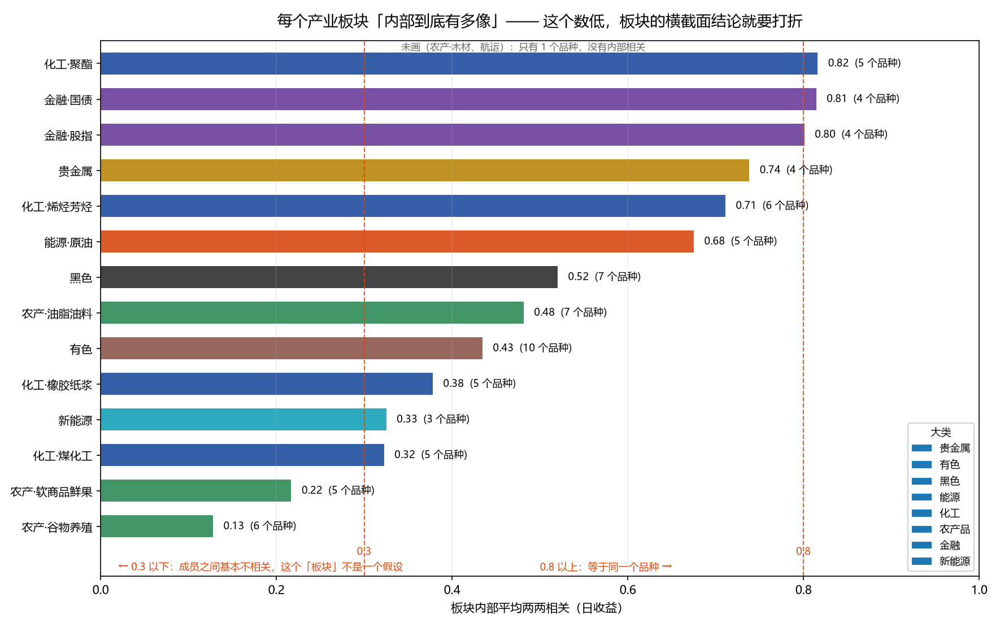
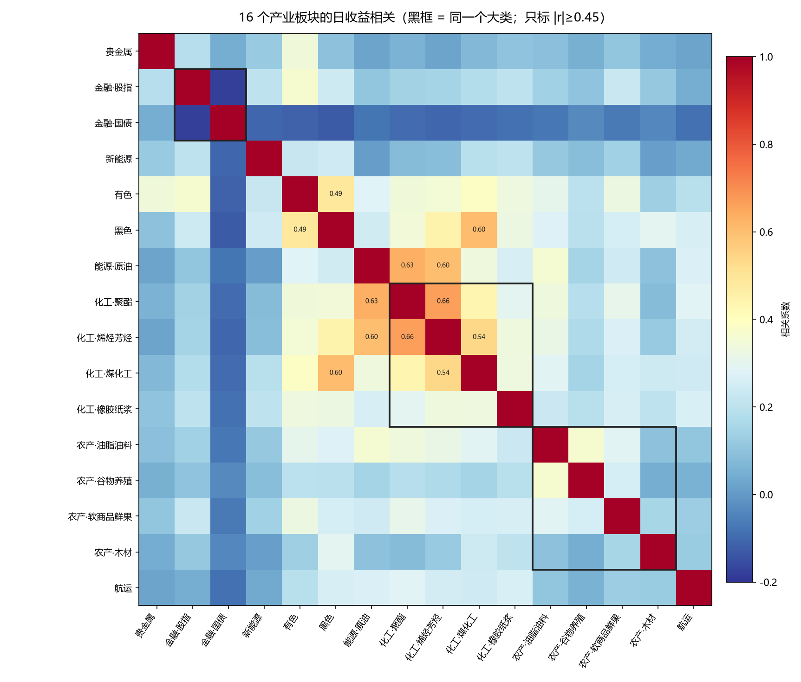
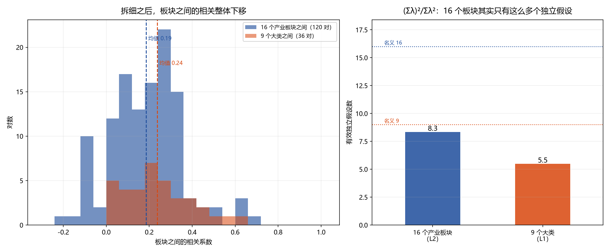

# 板块划分细化：L1 9 个大类 / L2 16 个产业板块（含相关度实测）

> 数据：主连日线 `1d_tq`，**前复权 qfq**，78 个品种，2016-01 ~ 2026-11-12。
> 相关 = 日收益 Pearson；板块指数 = 成员归一化净值等权平均；内部分量按两两相关取均值。
> 复现：`D:/_tools/sector_l2_corr.py`（读 DuckDB，约 1 分钟）。
> 代码：3.7.2 `8f4a590`（自检 79 项全绿）。
> 平台侧：`sector_list(level=2)` 看清单，`sector_corr()` 直接出这两张表。

## 先纠正我上一条消息里两个数错的

| 我说的 | 实际 | 怎么回事 |
|---|---|---|
| 「大类 6 个」 | **9 个** | 表格里明明是 9 行，嘴上写成 6 —— 合并「能源/能源化工/贵金属」的旧草稿没改掉 |
| 「产业板块 15 个」 | **16 个** | 表格是 16 行，数错了 |

所以最终落地是 **L1 = 9（不变）、L2 = 16**。L1 保持不动是有意的：
#128~#133 那批化工结论都是按「化工 = 21 个品种」做的，一改 L1 全部对不上号。

## 一、落地了什么（代码）

| 文件 | 改动 |
|---|---|
| `ttrade/futures.py` | 新增 `SECTOR_L2`（16 个产业板块）、`L2_PARENT`、`sector_l2_of()`、`l2_names()`、`l1_of_l2()`、`sector_maps_ok()`；`SECTOR_MAP`（L1）原样不动 |
| `ttrade/skills/sector.py` | `sector_list` 新增 `level` 参数（1/2）；板块名支持 `化工·聚酯` / `化工-聚酯` / `化工/聚酯`；新增第 4 个动作 **`sector_corr`**（板块内部 + 板块间相关） |
| `ttrade/selftest.py` | 新增「板块两层映射（L1 9 / L2 16 严格对齐）」—— 查并集相等、无重复认领、父级存在。**自检 79 项全绿** |

对齐是硬约束：**92 个代码每个恰好属于一个 L2，L2 并集必须等于 L1**。
漏一个品种它就会从那层的扫描里静默消失（照样跑完，只是少算几个，界面上看不出来），
所以这条写进自检了，改任何一边都会红。

## 二、16 个产业板块

| L1 大类 | L2 产业板块 | 代码数 | 本地有数据 | 成分 |
|---|---|---|---|---|
| 贵金属 | 贵金属 | 4 | 4 | AU AG PT PD |
| 有色 | 有色 | 10 | 10 | CU AL ZN PB NI SN SS AO BC AD |
| 黑色 | 黑色 | 8 | 7 | RB HC I J JM SF SM (WR) |
| 能源 | 能源·原油 | 7 | 5 | SC LU FU BU PG (ZC TC) |
| 化工 | 化工·聚酯 | 5 | 5 | TA EG PF PR PX |
| 化工 | 化工·烯烃芳烃 | 6 | 6 | L PP V EB BZ PL |
| 化工 | 化工·煤化工 | 6 | 5 | MA UR FG SA SH (ME) |
| 化工 | 化工·橡胶纸浆 | 5 | 5 | RU NR BR SP OP |
| 农产品 | 农产·油脂油料 | 9 | 7 | A B M Y P RM OI (RO RS) |
| 农产品 | 农产·软商品鲜果 | 5 | 5 | CF CY SR AP CJ |
| 农产品 | 农产·谷物养殖 | 14 | 6 | C CS JD LH PK RR (WH WS WT PM RI ER JR LR) |
| 农产品 | 农产·木材 | 1 | 1 | LG |
| 金融 | 金融·股指 | 4 | 4 | IF IH IC IM |
| 金融 | 金融·国债 | 4 | 4 | T TF TS TL0 |
| 新能源 | 新能源 | 3 | 3 | LC SI PS |
| 航运 | 航运 | 1 | 1 | EC |

括号里是已退市/无流动性的老代码（ME 甲醇旧码、ZC/TC 动力煤、WR 线材、郑商所旧码 8 个、
油脂旧码 RO/RS）。它们照原归属进链，不能出现「谁都不认」的代码。

## 三、每个板块「内部到底有多像」

| 板块 | 成分 | 内部平均相关 | 最像的一对 |
|---|---|---|---|
| 化工·聚酯 | 5 | **0.82** | TA·PX 0.96 |
| 金融·国债 | 4 | **0.81** | T·TF 0.93 |
| 金融·股指 | 4 | **0.80** | IC·IM 0.95 |
| 贵金属 | 4 | 0.74 | PT·PD 0.84 |
| 化工·烯烃芳烃 | 6 | 0.71 | PP·PL 0.96 |
| 能源·原油 | 5 | 0.68 | SC·LU 0.87 |
| 黑色 | 7 | 0.52 | RB·HC 0.93 |
| 农产·油脂油料 | 7 | 0.48 | M·RM 0.86 |
| 有色 | 10 | 0.43 | CU·BC 0.99 |
| 化工·橡胶纸浆 | 5 | 0.38 | RU·NR 0.93 |
| 新能源 | 3 | 0.33 | SI·PS 0.45 |
| 化工·煤化工 | 5 | 0.32 | FG·SA 0.59 |
| 农产·软商品鲜果 | 5 | **0.22** | CF·CY 0.73 |
| 农产·谷物养殖 | 6 | **0.13** | C·CS 0.77 |
| 航运 / 农产·木材 | 1 | — | 单品种，无内部相关 |

三个读法：

1. **>0.75 的四个（聚酯 0.82、国债 0.81、股指 0.80）在横截面上等于「同一品种重复」**。
   在这几个板块里，「因子在 5 个品种上有 4 个为正」根本不是 4 票，
   实际只有 1.2~1.5 票 —— 扫描出的漂亮一致性要按这个折扣看。
   配权时这几个板块也只该算 1~2 条腿，不是 4~5 条。
2. **<0.3 的两个（谷物养殖 0.13、软商品鲜果 0.22）反过来：它们不是一个假设，
   只是「放在同一个大类里的几件不同的事」**。在这两个板块上做横截面平均，
   等于把鸡蛋、生猪、花生的故事搅在一起，得到的结论没有可解释性。
3. 中间那批（0.32~0.68）才是「产业板块」这个概念真正成立的地方 ——
   成员同涨同跌但没到重复，横截面结论有信息量。

## 四、板块之间有多像

**最像的 8 对**（>0.4 = 在同一份风险里）：

| 相关 | A | B | 说明 |
|---|---|---|---|
| 0.66 | 化工·聚酯 | 化工·烯烃芳烃 | 同一条石脑油/原油成本端 |
| 0.63 | 能源·原油 | 化工·聚酯 | 成本传导 |
| 0.60 | 黑色 | 化工·煤化工 | 都吃煤/电/地产需求 |
| 0.60 | 能源·原油 | 化工·烯烃芳烃 | 同上 |
| 0.54 | 化工·烯烃芳烃 | 化工·煤化工 | 油头 vs 煤头，互为替代 |
| 0.49 | 有色 | 黑色 | 同属工业金属/地产链 |
| 0.45 | 黑色 | 化工·烯烃芳烃 | — |
| 0.44 | 化工·聚酯 | 化工·煤化工 | — |

**最不像的 8 对全跟国债有关**：

| 相关 | A | B |
|---|---|---|
| **−0.18** | 金融·股指 | 金融·国债 |
| −0.13 | 黑色 | 金融·国债 |
| −0.12 | 有色 | 金融·国债 |
| −0.10 | 金融·国债 | 新能源 |
| −0.10 | 化工·烯烃芳烃 | 金融·国债 |

**国债是这 16 个板块里唯一的负相关来源**，而且是跟几乎所有商品负相关。
原因不神秘：商品涨 → 通胀预期上来 → 利率上行 → 国债跌。
**这意味着「商品 + 国债」才是真正的两条腿**，而「化工加黑色」基本是同一条腿穿了两件衣服。

## 五、16 个板块其实只有 8 个独立假设

| 层级 | 名义板块数 | 板块间平均相关 | 有效独立假设数（(Σλ)²/Σλ²） |
|---|---|---|---|
| L1 大类 | 9 | 0.24 | **5.5** |
| L2 产业板块 | 16 | 0.19 | **8.3** |

**拆细的收益是实的：独立假设 5.5 → 8.3（+51%），板块间平均相关 0.24 → 0.19。**
但也要看清：16 个名字只买到 8.3 个假设，剩下那 7.7 个是换名字换出来的。
配 8 条以上板块腿时，边际上已经在加杠杆而不是加分散。

## 六、还能再拆三刀（数据支持，未落地）

实测这三个 L2 内部太散，拆开更干净：

| 现在 | 内部相关 | 拆成 | 拆后内部相关 |
|---|---|---|---|
| 化工·橡胶纸浆 | 0.38 | 橡胶（RU NR BR）/ 纸浆（SP OP） | **0.70 / 0.31** |
| 农产·谷物养殖 | 0.13 | 玉米链（C CS RR）/ 养殖（LH JD PK） | **0.30 / 0.08** |
| 农产·软商品鲜果 | 0.22 | 软商品（CF CY SR）/ 鲜果（AP CJ） | **0.42 / 0.22** |

拆完是 19 个产业板块。**注意「养殖」拆完还是 0.08** —— 生猪、鸡蛋、花生
本来就是三个独立故事，拆不拆都不是一条链，这类板块的正确用法是「当三个独立品种配」，
而不是「当一条链做横截面」。

要不要拆，取决于你怎么用：如果 L2 只用来**分组做横截面**，建议拆（0.38 的板块
内部结论不可解释）；如果只用来**看板块强弱**，16 个已经够细。

## 七、怎么用（三条规则）

1. **横截面扫描 → 用 L2**，并且先看内部相关：
   > 0.75（聚酯/股指/国债/贵金属）→ 结论要按「实际只有 1~1.5 票」打折；
   < 0.3（谷物养殖/软商品鲜果）→ 别在这个板块上数「几个品种为正」，改单品种看。
2. **配权/资产配置 → 用 L1 + 相关性**，不要按板块名数量配。商品那 7 个大类
   实际是 ~5 个假设，加上国债才是真正独立的第二条腿。
3. **`sector_relation` 在这个划分下有个新用法**：拿 L1 指数做分母，看某个 L2 的
   beta —— beta > 1 说明它是该大类的「高弹性代理」，这类链条适合放大做；
   beta < 0.5 说明它有自己的故事，别用大类信号去推它。

## 八、一个已知口径问题（未改）

`sector.py::_seg()` 算回撤用 `(s - peak) / peak`（分母峰值），而回测页
`backtest.metrics` 用**本金**做分母。所以 `sector_scan` 表里 IS/OOS 的卡玛
比回测页偏乐观，尤其 OOS 段涨得多的时候。要不要统一成本金口径，
等你确认 —— 改了以后旧扫描表的卡玛会整体下移，需要重跑才能对齐。
